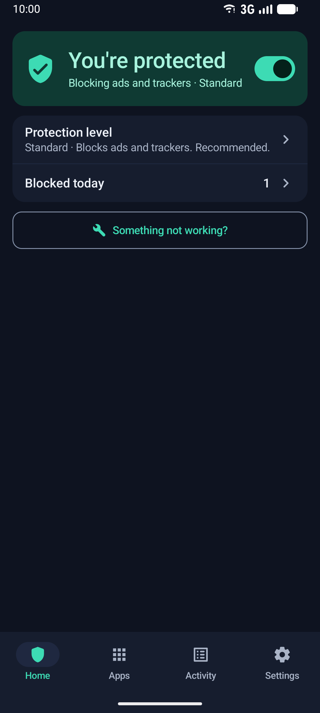
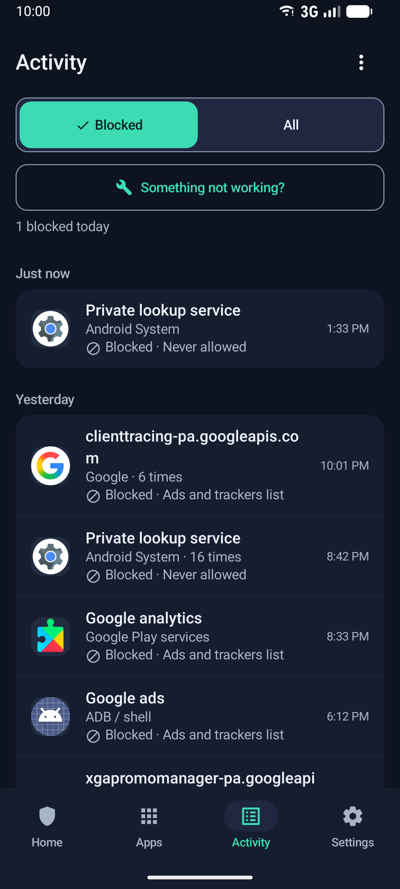
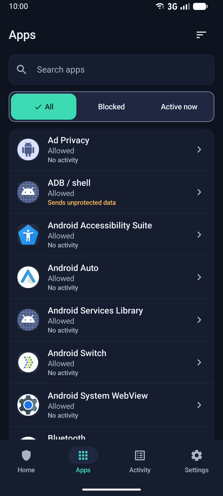
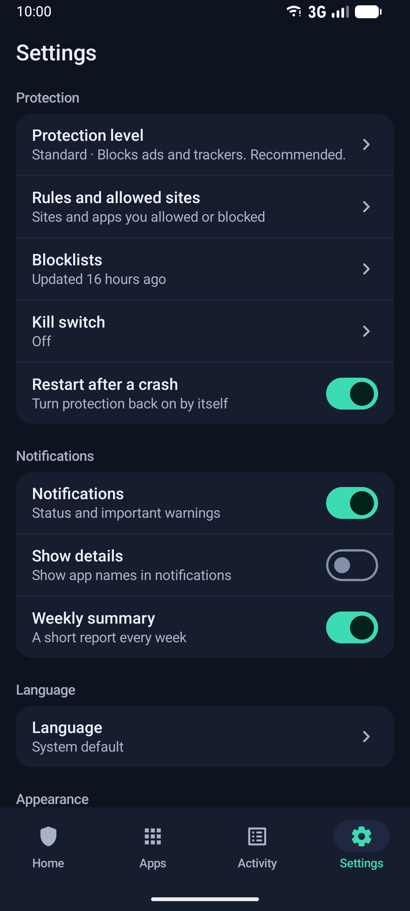
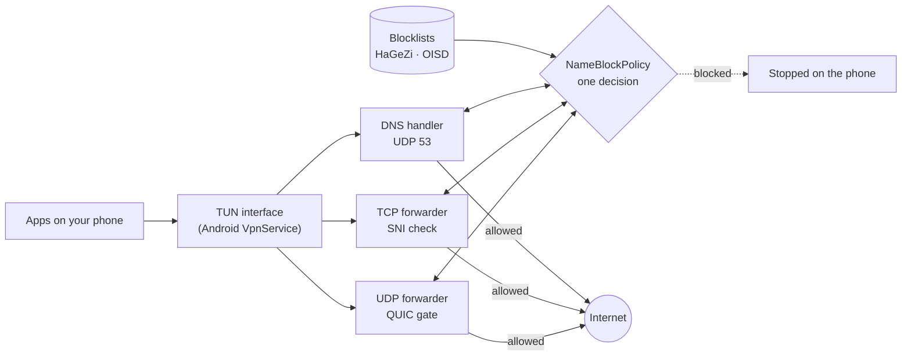
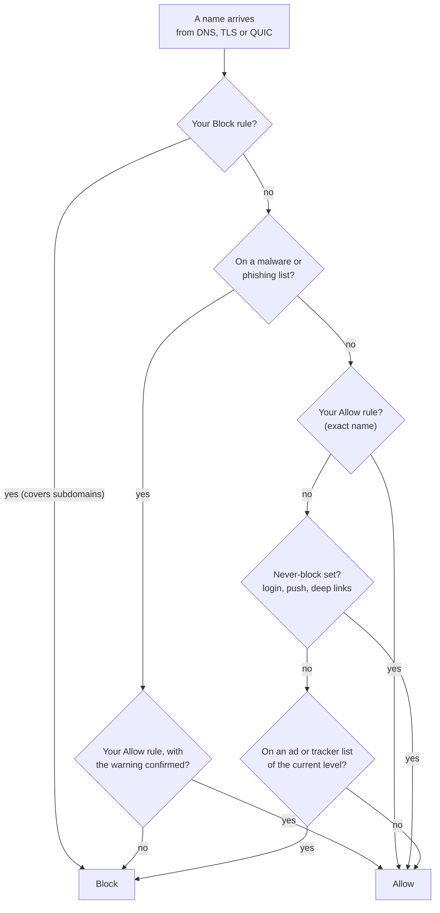
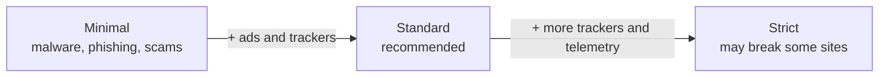
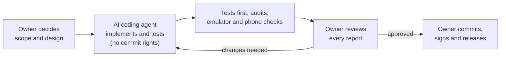

# CoreLock

**A privacy firewall for Android. No root. Nothing leaves your phone.**

[](LICENSE)
[](https://github.com/NAJJAT/CoreLock/releases/latest)
[](#install)
[](https://github.com/NAJJAT/CoreLock/actions/workflows/ci.yml)

CoreLock runs a **local VPN** on your phone and shows, per app, where your data goes:
which servers, which companies, how much, when (screen on or off, app open or in the
background) and why something looks suspicious. It blocks ads, trackers, malware and
phishing by server name, watches TLS behaviour, and explains what it finds in plain
language in **English, Dutch, French and Arabic**.

## Screenshots

| Home | Activity | Apps | Settings |
|:---:|:---:|:---:|:---:|
|  |  |  |  |

Taken on the Android emulator with the 1.2.1 build in preparation; no personal data.

## Highlights

- **Blocks malware, phishing, ads and trackers for every app**, not only in the browser.
- **Per-app control:** block an app completely or only in the background, and see where
  each app connects.
- **Works everywhere:** on every Wi-Fi network and on mobile data, because it runs on the
  phone itself.
- **Apps can't sneak around it:** encrypted DNS (DoT, known DoH servers) is stopped, and
  the server name of every connection is checked again.
- **No account, no server, no root.** Analysis runs on the device; the only outbound
  requests are listed in [Network requests the app makes](#network-requests-the-app-makes).
- **Open source** under GPL-3.0, released as a signed APK on GitHub Releases (not Google
  Play).
- **Honest about its limits:** it shows destinations, sizes and timing, not the content
  of encrypted traffic; every number opens the exact list it was counted from; and what
  it cannot block is written down ([Known limitations](#known-limitations)).

> App name on the device: **CoreLock**. Application ID:
> `com.privacyguard.app.enterprise`
> ([why it says privacyguard](#why-does-the-package-name-say-privacyguard)).

## Contents

1. [What CoreLock is, and what it is not](#what-corelock-is-and-what-it-is-not)
2. [How it works](#how-it-works)
3. [Install](#install)
4. [Recommended settings](#recommended-settings)
5. [Privacy](#privacy)
6. [Frequently asked questions](#frequently-asked-questions)
7. [Known limitations](#known-limitations)
8. [Documentation](#documentation)
9. [For developers](#for-developers)
10. [Contributing](#contributing)
11. [Security](#security)
12. [License and credits](#license-and-credits)

---

## What CoreLock is, and what it is not

**It is** a firewall and privacy monitor that runs on your phone. All traffic goes
through a local VPN on the device. Nothing is sent to a server of ours; there is none.
It is one app: monitoring and blocking, plus optional HTTPS inspection, MDM and SIEM
shipping for company-managed phones.

**It is not:**

- **A remote VPN.** Your traffic is not routed through an outside server, so it **does
  not hide your IP address** ([FAQ](#does-corelock-hide-my-ip-address)).
- **A content-filtering ad blocker.** It decides by server name, not by page content. It
  **cannot remove ads inside YouTube, Instagram, Snapchat, TikTok or Facebook**, which come
  from the same servers as the content ([FAQ](#why-do-i-still-see-ads-in-youtube-instagram-or-snapchat)).
  It can't hide ads drawn inside a page, or see names hidden by Encrypted Client Hello.
- **Protection while it isn't running.** While the tunnel is down (for example right
  after a crash) nothing is filtered unless Android's Always-on VPN with *Block
  connections without VPN* is on ([Recommended settings](#recommended-settings)).

**HTTPS inspection is off by default** and needs your explicit consent. Even when on,
most apps on Android 7 and newer ignore user-installed certificates, so their traffic
stays encrypted and only its metadata is shown. See
[HTTPS inspection: what it can and cannot do](#https-inspection-what-it-can-and-cannot-do).

## How it works

### The path of a connection



CoreLock blocks in four layers, and every layer uses the same decision for a name, so a
name blocked in one cannot slip through another:

1. **DNS blocking.** When an app looks up a blocked name, CoreLock answers "this name
   does not exist", so no connection is made. Aliases (CNAME) and service records
   (HTTPS/SVCB) that point to a blocked name are blocked too.
2. **No way around the filter's DNS.** DNS over TLS (port 853) and known encrypted-DNS
   (DoH) servers are stopped, so apps fall back to the DNS that CoreLock checks.
3. **The server name of each connection.** The name an app sends when it opens a secure
   connection (TLS or QUIC), or the site name of an unencrypted web request, gets the
   same decision as DNS. At Standard and Strict, a connection whose name can't be read is
   stopped rather than let through.
4. **Per-app firewall.** You can block an app completely, or only in the background.

Every connection is recorded with its app, server, size, timing and encryption, and every
block says what stopped it. Detectors look for odd DNS names, TLS changes, timer-like
contacts, behaviour changes and stalkerware traits. The full list of features is in
[docs/architecture/FEATURES.md](docs/architecture/FEATURES.md).

### How one name is decided



Your Block rule always wins. Malware sits above your Allow rule, so a mistaken Allow
can't open a known phishing site unless you confirmed the warning when you created it.
Ads sit below your Allow rule, so you can always fix a broken site. A few hosts that
carry both tracking and something people need (login, push messages, deep links) are
never blocked by the ad and tracker lists. Between two of your own rules, the more
specific rule wins, and Block wins a tie.

### Protection levels



| Level | Blocks | Lists | About | Trade-off |
|---|---|---|---|---|
| **Minimal** | Malware and phishing only | HaGeZi Threat Intelligence Feeds mini | 213,000 names | Ads and trackers load normally. |
| **Standard** (default) | + ads and trackers | + HaGeZi Pro mini and built-in ad and analytics hosts | 287,000 names | Recommended: few broken sites. |
| **Strict** | + telemetry (OS and vendor diagnostics; can break features that depend on them) | Full HaGeZi Pro instead of Pro mini, + OISD small; QUIC blocked by default | 342,000 names | Most blocking; some features and sites may break. |

At every level: your own rules (the more specific rule wins; Block wins a tie), the
ad-SDK policy when it is on, and the HaGeZi DoH lists that stop apps from skipping
the filter with encrypted DNS.

What each level blocks, what is left open on purpose, what cannot be blocked, and how
to allow a site or report a wrong block: [docs/BLOCKING_POLICY.md](docs/BLOCKING_POLICY.md).

## Install

CoreLock is published only on
[GitHub Releases](https://github.com/NAJJAT/CoreLock/releases), not on Google Play.
It runs on Android 7.0 and newer (ARM phones, 64- and 32-bit).

Latest version: **1.2.0** ([release notes](docs/releases/RELEASE_NOTES_1.2.0.md)).
Earlier: [1.0.0](docs/releases/RELEASE_NOTES_1.0.md). All versions:
[changelog](docs/releases/CHANGELOG.md). Versions 1.0.1 and 1.1.0 were never published;
1.2.0 updates 1.0.0 directly.

### 1. Download

On the phone, download the APK (`CoreLock-1.2.0.apk`) from the release page.

### 2. Verify before installing

The release page lists the APK's SHA-256 and the signing certificate's SHA-256
fingerprint (also under [Security](#security)). For 1.2.0:

```
Signing certificate SHA-256: caa82092caf86f9ce7d94f5b7c4a4476a3eb1a5bfa238f7b1d18cd85809bc430
APK file SHA-256:            299663f8e7119656630572c3e67d7c22b1a7153b0bebb19de4a9c3acca10b26e
APK file size:               12,234,900 bytes (11.7 MiB)
```

On a computer with the Android SDK build-tools:

```bash
apksigner verify --print-certs CoreLock-1.2.0.apk   # certificate fingerprint
sha256sum CoreLock-1.2.0.apk                        # Linux / macOS
certutil -hashfile CoreLock-1.2.0.apk SHA256        # Windows
sha256sum -c SHA256SUMS.txt                         # with SHA256SUMS.txt from the release page next to the APK
```

Install only if both match. (`keytool -printcert -jarfile` does not work: the APK is
signed with APK Signature Scheme v2 only.) An automatic check on each release confirms
the APK is signed with the key under [Security](#security).

### 3. Install

Open the APK. Android asks to allow installs from the app you used (browser or file
manager): allow it for this install, then turn it off again.

### 4. First setup

1. **VPN permission.** Open CoreLock and follow the three setup screens; Android asks
   once to allow the VPN. "What leaves this phone" on the second screen lists what the
   app sends and stores. Everything else stays on the phone.
2. **Protection level.** Standard is the default; see
   [Protection levels](#protection-levels).
3. **Private DNS.** Set Android's Private DNS to Off or Automatic; the app warns you on
   Home and before starting if it is set to a hostname
   ([why](#recommended-settings)).
4. **Battery.** Setup warns you when Android restricts CoreLock in the background.
   Settings › Advanced › Diagnostics › Battery use shows whether Android may stop
   protection in the background, and opens the battery settings.
5. **Notifications.** Allow them when CoreLock asks: "Protection stopped" is a
   notification. While they are off, Home shows a card that opens their settings.
6. **Kill switch.** Turn on Always-on VPN for CoreLock
   ([Recommended settings](#recommended-settings)).
7. **Language.** Settings › Language: System default, English, العربية, Français
   or Nederlands.

### 5. Updating from older versions

- Install the newer APK over the old one (1.2.0 installs over 1.0.0); your data stays.
  Android refuses an APK signed with a different key.
- The first start after the update takes a few seconds longer: CoreLock checks the lists
  1.0.0 kept, once, and lets nothing through until then.
- If you used HTTPS inspection in 1.0.0, install the new certificate from the card on
  Home.
- **Google's developer verification.** Google has announced that from 2027 Android may
  also check sideloaded apps against developers registered with Google. Nothing changes
  for installs today; what it will mean for CoreLock is in
  [docs/project/GOOGLE_DEVELOPER_VERIFICATION.md](docs/project/GOOGLE_DEVELOPER_VERIFICATION.md).

## Recommended settings

- **Always-on VPN with "Block connections without VPN"** (Android's VPN settings, for
  CoreLock). This is the kill switch, and only Android can provide it: once the tunnel
  is gone (after a crash, before the first unlock after a restart, or while the app
  updates), only Android can block traffic. With it on, there are no gaps in protection.
- **Chrome's "Use secure DNS" on automatic.** In Chrome, open Settings › Privacy and
  security › Use secure DNS and choose "Use your current service provider". A specific
  provider (for example Cloudflare) makes pages fail with
  `DNS_PROBE_FINISHED_BAD_SECURE_CONFIG`, because CoreLock blocks that encrypted DNS
  server so it can't skip the blocklist.
- **Android's Private DNS on "Automatic"** (or Off). If it is set to a hostname, every
  lookup fails while protection runs: Android then uses only that encrypted server,
  which CoreLock blocks so the filter can't be skipped. In Automatic mode Android falls
  back to plain DNS, which CoreLock checks.

## Privacy

There is no analytics, no crash reporting and no update check. Everything the app
collects stays on the phone, in an encrypted database.

### Network requests the app makes

| Request | When | What the other side learns |
|---|---|---|
| Upstream DNS (default 1.1.1.1; configurable, IP address only) or DoH (Cloudflare / Google / Quad9) | Every DNS lookup by any app; only to the chosen provider | The names looked up, from your IP |
| Blocklists (raw.githubusercontent.com, cdn.jsdelivr.net as fallback mirror, small.oisd.nl) and the Exodus tracker list (reports.exodus-privacy.eu.org) | Blocklists: at first start (any network); weekly on Wi-Fi or another unmetered network; on any network once a list has had no successful download for 14 days; failed lists are retried; "Refresh now" at any time. About 4 MB compressed for all lists. Exodus list: at most weekly | That the app is installed, from your IP |
| crt.sh (Certificate Transparency) | Only if turned on in Settings | Registrable domains of TLS servers you contact |
| api.ipify.org | Only if "External IP check" is on, when diagnostics run | Your public IP |
| SIEM endpoint (set by MDM) | Only on a company-managed phone, when the administrator enables shipping | Payload metadata; HTTPS with optional pinning and signing |
| The two SOCKS5 servers you enter for Dual VPN (first and second hop) | Only while Dual VPN is on: every TCP connection, and DNS when DoH is on | The first server sees your IP address; the second sees the hosts you connect to. SOCKS5 itself is not encrypted, so the first server can read those host names and your SOCKS5 user names and passwords too. The content of HTTPS connections stays encrypted. |

Everything else (history, fingerprints, baselines, sensor events, reports) stays on the
device. There is no analytics, no crash reporting and no update check: Settings › About
opens the GitHub releases page in your browser instead.

### What the app can and cannot see

| Sees | Does not see |
|---|---|
| Which app opened a connection, to which IP and hostname (DNS or TLS SNI) | The content of encrypted (HTTPS) traffic, unless HTTPS inspection is on and that app trusts the user CA (most apps on Android 7+ do not) |
| Bytes sent and received, start time and duration | Which ad you were shown, or what an app sent inside TLS |
| Whether the screen was on, and (with Usage Access) whether the app was on screen | Foreground/background without Usage Access (shown as "unknown", never guessed) |
| DNS lookups, blocked or allowed | The app behind a lookup that goes through Android's shared resolver (see below) |
| When the mic or camera is in use | Which app holds the mic or camera (Android hides it; a likely app is shown) |

**DNS attribution.** Apps resolve names through Android's shared resolver, so a
lookup packet belongs to the resolver, not the app. A lookup is credited to the
app that connects to the answer within a minute; blocked or unused lookups stay
"not attributable".

### Data storage

- **Two databases.** History is large and disposable. Your configuration (rules, list
  toggles) lives in a separate config database, so clearing history never deletes your
  rules. The tables are listed in [docs/architecture/CODE_MAP.md](docs/architecture/CODE_MAP.md#databases).
- **Encryption at rest.** SQLCipher, with a passphrase wrapped by an Android
  Keystore key, so the database files are unreadable off the device.
  Plaintext databases from older installs are encrypted in place. The key is
  only unwrapped when a database is first used, off the main thread. SIEM
  events waiting to be sent are held in memory only.
- **What history holds:** per connection the app, IP/port, hostname, server name, bytes,
  time, encryption, foreground and screen state; per DNS lookup the app (when known),
  name, whether it was blocked, and screen and foreground state. Also the per-app TLS
  baseline, detector findings, mic/camera use, network trust and, with HTTPS inspection
  on, the inspected payloads.
- **Retention.** A daily job deletes history past the retention you choose
  (7/14/30/90 days) and caps the large tables at 500,000 rows. A weekly VACUUM
  compacts the file.
- **Clear all collected data** (Settings) erases every history table, exports,
  PCAPs, the Certificate Transparency record, SIEM events waiting to be sent, and what
  the running VPN holds in memory; settings, rules and blocklists stay.
- **Export and import of rules and settings** (Settings › Data): a JSON file saved where you
  choose with Android's file picker. It holds your rules and settings, never history,
  passwords, keys or HTTPS-inspection data; keep it private. Import shows what it will add
  and change before anything happens, adds rules without replacing yours, never lets an
  imported rule override malware protection, and is turned off on phones an organisation
  manages (ADR 0013).
- **Screen privacy.** `FLAG_SECURE` blocks screenshots and recents thumbnails
  (Settings › Allow screenshots turns it off).
- **Sensitive actions** (exports, PCAP, clearing data) require device
  authentication and are blocked on a tampered runtime. `AppSecurityMonitor`
  checks signature, debugger, root packages, emulator and build tags.
- **Backups.** None. `allowBackup="false"` and `fullBackupContent="false"`
  turn backup off on every Android version, and `data_extraction_rules.xml`
  also excludes device-to-device transfer on Android 12+.

What is stored where, for how long, and what leaves the phone, in full:
[HOW_IT_WORKS.md §7](docs/architecture/HOW_IT_WORKS.md#7-privacy-what-is-stored-for-how-long-and-what-leaves-the-phone).

### HTTPS inspection: what it can and cannot do

- **Off by default.** Nothing is decrypted unless you turn it on in the app and
  confirm the consent screen. Turning it off deletes the signing key.
- **On a company-managed phone** your organisation's MDM can turn it on and give
  consent on your behalf (`mitm_enabled`, `mitm_consent_given`). Nothing else can:
  only your own switch and consent in the app, or the MDM of a phone your
  organisation manages. When that policy is removed, what it turned on ends.
- **Never silent.** While it decrypts, the VPN notification and the Home screen
  say so, and say when your organisation turned it on. You also get a
  notification the moment your organisation turns it on.
- **It needs a certificate you install.** The app makes a certificate authority
  (CA) on the phone; you install it in Android's settings yourself. The CA lasts
  97 days and is renewed with your consent every 90 days.
- **Most apps ignore it.** Since Android 7, apps trust user-installed
  certificates only if their developer allows it, and most do not. Their traffic
  stays encrypted; CoreLock shows only its metadata (app, server, size, time)
  and says why. Apps that pin certificates are passed through the same way. In
  practice inspection mostly reaches some browsers and apps built to allow it.
- **Who can see the content:** it stays on the phone, in the encrypted database,
  unless an administrator turns on SIEM shipping. Shipped events are always
  redacted: personal data is removed from headers and text bodies, values in URL
  query strings and form data are replaced, and binary bodies are kept as type and
  size only.

Technical detail, MDM keys and SIEM:
[docs/architecture/FEATURES.md](docs/architecture/FEATURES.md#https-inspection-mdm-and-siem).

### Permissions

<details>
<summary>Every permission and why CoreLock needs it</summary>

| Permission | Why |
|---|---|
| `BIND_VPN_SERVICE` (service) | Create the TUN interface |
| `FOREGROUND_SERVICE`, `FOREGROUND_SERVICE_SPECIAL_USE` | The VPN runs as a foreground service (`specialUse`, required on API 34+) |
| `INTERNET`, `ACCESS_NETWORK_STATE`, `ACCESS_WIFI_STATE`, `CHANGE_NETWORK_STATE` | Forward traffic, DoH, network trust per Wi-Fi |
| `QUERY_ALL_PACKAGES` | Show app names and icons for every connection; APK tracker scan |
| `PACKAGE_USAGE_STATS` (user-granted Usage Access) | Foreground/background per connection, likely app for mic/camera, "app not opened" empty state |
| `POST_NOTIFICATIONS` | Alerts (TLS fingerprint change, cleartext, background block, protection stopped, weekly report) |
| `RECEIVE_BOOT_COMPLETED` | Restart the VPN after reboot |
| `WAKE_LOCK` | Used by WorkManager for background jobs (blocklist refresh, pruning, weekly report) |
| `SCHEDULE_EXACT_ALARM` | Restart protection after a crash (Android only allows it from an exact alarm); set only after a crash |
| `WRITE_EXTERNAL_STORAGE` (Android 9 and older only, `maxSdkVersion="28"`) | Save the HTTPS-inspection CA certificate to Downloads so you can install it; asked at runtime, only when you export the CA. Exports (PCAP, CSV) are app-private and need no permission. |
| Device admin (`BIND_DEVICE_ADMIN` receiver) | For company MDM (Intune, Workspace ONE, Jamf). Does nothing until a user or MDM activates it. |
| Debug only: `DUMP` (receiver guard) | Debug hooks callable only from adb |

</details>

### Screens

<details>
<summary>What is on each screen</summary>

Four tabs: **Home**, **Apps**, **Activity** and **Settings**. Expert screens are under
Settings › Advanced. Every 1.0 screen is still there; where each moved is in
[RELEASE_NOTES_1.2.0.md](docs/releases/RELEASE_NOTES_1.2.0.md) ("Where things moved").

| Screen | Contents |
|---|---|
| **Onboarding** | Three screens: what CoreLock does and can't do; why Android asks about a VPN, with what leaves the phone; the protection level (battery advice only when Android restricts the app). HTTPS inspection is not offered here: its consent is only on its own screen. |
| **Home** | Whether you are protected, with one switch; protection level; blocked today; "Something not working?" (find and allow what an app needs in 3 taps, or pause protection for 5 minutes); a warning card when something needs attention. |
| **Activity** | What was blocked or allowed, in plain words, grouped by time, repeats merged. A row opens why it happened, with Allow / Block for that app or everywhere and Undo; technical details folded away. ⋮ › Live connections shows the 1.0 live list. |
| **Apps** | Apps with search, filters (All / Blocked / Active now) and sorting; status, blocked today and one plain risk word per app. |
| **App detail** | Internet access (allowed, blocked in background, blocked); what it connected to recently; built-in trackers; Technical details with every 1.0 tab (permissions vs traffic, behaviour, timeline, names, *See every connection*, inspected content). |
| **App traffic / Domain detail** | By purpose, every connection and raw DNS for an app; a name's owner, purpose, apps and the same Allow / Block choices. |
| **Settings** | Protection (level, Rules and allowed sites, Blocklists, Kill switch, Restart after a crash), Notifications, Language, Appearance, Data (history length, export history, export and import of rules and settings, screenshots, clear data), About. |
| **Rules and allowed sites** | Your rules titled by site, app or address, with search, switches, Undo, suggestions and an add sheet that checks what you typed. |
| **Advanced › Network** | DNS server, encrypted DNS, QUIC, unencrypted and outdated-encryption blocking, certificate checks, public-IP check, two proxy servers. |
| **Advanced › HTTPS inspection** | Captured HTTPS requests and responses for apps that allow it, risk, CA install; asks before every switch-on. |
| **Advanced › Analysis** | Security analysis (TLS fingerprints, ciphers, CT), Statistics (score, network map, heatmap, trends, CSV and IT exports, PCAP), Alerts, Security systems (the 1.0 Home cards and their lists), Night report, Ad privacy, Ads & trackers. |
| **Advanced › Diagnostics** | Checks, app integrity, battery, per-list counts and update times, block counters, connection limits and handled errors. |

</details>

## Frequently asked questions

CoreLock is an open-source privacy firewall that also blocks ads from separate ad
servers; it is not a content-filtering ad blocker.

### Why do I still see ads in YouTube, Instagram or Snapchat?

These apps send their ads from the same servers as the videos, photos and stories.
CoreLock blocks by server name, so it cannot block the ads without also blocking the
content, which would break the app. It does block known separate ad and analytics
servers (Snapchat's own ad servers, for example), but most ads in these apps do not
come from those. Without root, no blocker can separate these ads from the content.
The same is true for TikTok and Facebook. See
[What CoreLock cannot block](docs/BLOCKING_POLICY.md#6-what-corelock-cannot-block).

### How is CoreLock different from AdGuard or Pi-hole?

- **Server names, not page content.** CoreLock decides by the name of the server an
  app connects to. AdGuard can also filter inside web pages (hide elements, block
  single addresses) in browsers that trust its certificate. CoreLock does not filter
  page content.
- **One phone, everywhere.** Pi-hole filters DNS for the devices on the network where
  it runs, usually a home network. CoreLock runs on the phone itself, so it filters on
  every Wi-Fi network and on mobile data.
- **Per-app rules.** CoreLock knows which app made each connection: you can block an
  app, block it only in the background, or set rules for one app, and see where each
  app connects.
- **Open source, no servers of its own.** All of CoreLock's code is published under
  GPL-3.0. There is no CoreLock server: the few hosts the app contacts (blocklists,
  your DNS resolver) are listed in
  [Network requests the app makes](#network-requests-the-app-makes).

CoreLock is not affiliated with or endorsed by AdGuard.

### How do I get YouTube without ads?

CoreLock cannot do this (see above). What works is a browser with a content blocker,
for example Firefox with the uBlock Origin add-on, and watching YouTube there instead
of in the YouTube app. It removes ads on websites that CoreLock cannot reach, and you
can keep CoreLock on for everything else.

### A site or app stopped working. What do I do?

On Home, tap **Something not working?**: it shows what was blocked for that app in the
last hour and lets you allow it in a few taps, or pause protection for 5 minutes. You can
also open a blocked row in the **Activity** tab and choose *Allow for this app* or *Allow
everywhere*. More in the
[blocking policy](docs/BLOCKING_POLICY.md#8-how-to-allow-list-a-domain-or-an-app).

### Does CoreLock hide my IP address?

No. CoreLock's VPN is local: it runs on the phone and sends your traffic straight to
its destination. Nothing is routed through an outside server, so websites and apps
see your normal IP address, and your DNS resolver sees which names you look up. (The
optional Dual VPN setting is the exception: it sends connections through SOCKS5
servers you configure yourself, and those servers see your IP address instead.)

### Why does the package name say privacyguard?

CoreLock was first developed as PrivacyGuard. The application ID stays
`com.privacyguard.app.enterprise` because Android only installs an update over an
app with the same ID: changing it would make installed apps unable to update. Other
internal names (database and settings files, notification channels, the Keystore alias)
keep it for the same reason; everything you see says CoreLock. The full list:
[Internal names](docs/architecture/CODE_MAP.md#internal-names).

## Known limitations

- **In-app ads in YouTube, Instagram, Snapchat, TikTok and Facebook can't be blocked
  without root.** They come from the same servers as the content, so blocking them by
  name would break the app. More limits of name-based blocking are in
  [docs/BLOCKING_POLICY.md](docs/BLOCKING_POLICY.md#5-limits-of-domain-level-blocking).
- **Encrypted Client Hello (ECH)** hides the real server name of some browser
  connections; CoreLock sees only a shared outer name. At Strict, an optional setting
  (off by default) removes the ECH key from DNS answers so the real name is readable;
  your network can then see it too. Details in
  [docs/BLOCKING_POLICY.md](docs/BLOCKING_POLICY.md#6-what-corelock-cannot-block).
- **The kill switch is Android's.** While CoreLock is not running (after a crash, or
  before the first unlock after a restart) traffic is not filtered unless Android's
  Always-on VPN with *Block connections without VPN* is on for CoreLock. Updating the
  app also stops the VPN unless Always-on VPN is on.
- **With notifications off, a crash can't be reported to you.** Home shows a card until
  you turn them on.
- **Per-app rules at the DNS layer.** Android's resolver makes the lookup, not the app,
  so per-app Allow rules and ad-SDK exceptions apply only to the connection itself.
- **Per-app rules on Android 7 to 9.** On these versions a per-app rule can
  occasionally apply to the wrong app. Android 10 and newer are not affected.
- **Meta app events** share `graph.facebook.com` with login, so they cannot be
  blocked without breaking "Continue with Facebook".
- **Chrome's "Use secure DNS" must stay on automatic.** If it is set to a
  specific provider (for example Cloudflare), Chrome sends every lookup to that
  encrypted DNS server and does not fall back. CoreLock blocks that server,
  because it would skip the blocklist, so pages fail to load with
  `DNS_PROBE_FINISHED_BAD_SECURE_CONFIG`. In Chrome, open Settings › Privacy and
  security › Use secure DNS and choose "Use your current service provider".
  Other apps with a fixed encrypted-DNS provider may fail the same way.
- **Address rules are IPv4 only.** IPv6 connections are still checked by name and by app.
- **Fragmented UDP is dropped.** UDP datagrams larger than the tunnel's packet size
  arrive in fragments, which carry no port to match an app or rule, so CoreLock drops
  them (counted in Settings › Advanced › Diagnostics). Apps that rely on such large
  datagrams fail.
- **Large DNS answers** need DNS over TCP, which the tunnel does not offer, so
  answers that do not fit in a 4 KB UDP reply fail.
- **HTTPS inspection on a managed phone without Device or Profile Owner rights:** when
  the inspection certificate is renewed, CoreLock can't install the new one itself.
  Until it is installed, connections pass through undecrypted and Home says so.
- **TLS fingerprints:** learning covers only what an app does in its first 7 days, so a
  feature used later can alert once; new fingerprints are accepted silently after an
  update, which is also when a malicious SDK could arrive; QUIC is not fingerprinted.
  The JA3 watch-list is small and unverified; treat matches as hints.
- **"First-party" is judged from hostnames.** A first-party label can include
  the maker's own analytics on the same servers. IP-only connections show
  "owner unknown".
- **Usage Access is needed** for foreground/background, the likely app behind
  mic/camera use, and the "app not opened" empty state. Without it the app
  shows "unknown".
- **History is written when a connection closes** (or after 5 minutes idle for
  TCP, 30 s for UDP). Very recent, still-open connections appear a little later.
- **Forwarding stalls under heavy load** (rare TLS `BAD_RECORD_MAC`) were traced
  to server→app segments being dropped at a full TUN queue and never resent.
  `TcpForwarder` now reads only what the app's window and the queue can take
  and retransmits lost segments; this still needs confirming on a device.
- **Translations need native review.** The Arabic, French and Dutch texts are machine
  translations ([docs/translations/](docs/translations/README.md)).

The technical list, with every limit and the reason for it, is in
[HOW_IT_WORKS.md §9](docs/architecture/HOW_IT_WORKS.md#9-known-limits).

## Documentation

Everything else is indexed in [docs/README.md](docs/README.md). The main documents:

- [How CoreLock works](docs/architecture/HOW_IT_WORKS.md): the path of one connection,
  how every number is calculated, each detector and its thresholds, what is stored and
  what leaves the phone.
- [Blocking policy](docs/BLOCKING_POLICY.md): what each level blocks, what is left open on
  purpose, and how to report a wrong block.
- [Feature reference](docs/architecture/FEATURES.md) and [code map](docs/architecture/CODE_MAP.md).
- [Architecture decisions](docs/adr/README.md) and the [changelog](docs/releases/CHANGELOG.md).
- [Development guide](docs/project/DEVELOPMENT.md): building, signing, tests, CI and debug
  tools.

## For developers

### Build from source

Requirements: Android Studio with JDK 17, Android SDK 36 (minimum API 24).

```bash
./gradlew :app:assembleEnterpriseDebug          # debug build
```

A release build needs your own signing key, set up from
`release-signing.properties.template`; it refuses to fall back to the debug key. An APK
you sign yourself can't update the official CoreLock. Signing steps, tests, CI and debug
tools: [docs/project/DEVELOPMENT.md](docs/project/DEVELOPMENT.md).

### Run the tests

```bash
./gradlew :app:testEnterpriseDebugUnitTest          # unit tests (JVM)
./gradlew :app:lintEnterpriseDebug                  # lint
./gradlew :app:connectedEnterpriseDebugAndroidTest  # instrumented tests, emulator only (it uninstalls the app)
```

Tests never touch the real network. What each kind of test covers and how CI runs them:
[DEVELOPMENT.md › Tests](docs/project/DEVELOPMENT.md#tests).

### Project structure

```
app/src/
├── main/        the shared engine and UI (Kotlin, Jetpack Compose)
│   └── java/com/privacyguard/
│       ├── core/      packet, DNS, TLS and HTTP parsers, filters
│       ├── vpn/       forwarders (DNS, TCP, UDP), NameBlockPolicy, QuicGate, DnsBypassGuard
│       ├── platform/  the VPN service and Android integration
│       └── app/       blocklists, detectors, Room databases, workers, screens
├── enterprise/  HTTPS inspection, MDM and SIEM
├── debug/       debug-only tools (never in a release build)
├── test/        JVM unit, property and fuzz tests
└── androidTest/ instrumented tests and Room migrations
docs/            documentation (index: docs/README.md)
tools/           GeoIP table generator and repro scripts
```

The full map: [docs/architecture/CODE_MAP.md](docs/architecture/CODE_MAP.md).

### Working on CoreLock with an AI coding assistant

CoreLock can be developed with an AI coding assistant such as Claude Code. The assistant
writes code, tests and documentation; the owner keeps every decision, every review, every
commit and every release.

#### Start here

- [CLAUDE.md](CLAUDE.md) is the engineering handbook: hard rules, threat model,
  architecture, standards and the report format. Claude Code reads it automatically when
  it starts in this repository, and so should every human contributor.
- [How this project was built](docs/project/HOW_THIS_PROJECT_WAS_BUILT.md) explains how
  AI assistance was used so far and how the work was checked.

The rules from CLAUDE.md that matter most:

- **The agent never commits, pushes or merges, and never touches signing keys.** The
  owner reviews and commits every change and signs every release.
- **Fail closed.** At Standard and Strict, a connection whose destination can't be read
  is stopped, not let through; and the app never claims protection it isn't giving.
- **Tests first, with proof.** Every fix comes with a test that is shown to fail without
  the fix.
- **One decision path.** Every name (DNS, CNAME, TLS and QUIC server names) is decided by
  `NameBlockPolicy`, so no layer can disagree with another.
- **No new network destinations or dependencies** without the owner's approval. Every
  host the app contacts is listed in this README; a test fails when one is missing from
  the setup screen that tells users what leaves the phone.
- **Public repository:** security findings stay generic until they are fixed.

#### Requirements

- [Claude Code](https://claude.com/claude-code), or another assistant that reads
  `CLAUDE.md`.
- Android Studio with JDK 17 and the Android SDK 36 (see
  [Build from source](#build-from-source)).
- An Android emulator. The instrumented tests uninstall the app, so run them on an
  emulator, never on your own phone.

Start Claude Code from the repository root (`cd CoreLock`, then `claude`). Only then
does it load `CLAUDE.md` and the shared settings in `.claude/settings.json`. Type
`/permissions` to see the deny rules that are active.

#### Skills

Skills are instruction packs the assistant loads for a specific kind of task. **No skill
is stored in this repository:** each developer installs the ones they want (next
section), so the copies stay up to date and the repository holds no third-party code.

| Skill | What it is for in CoreLock | Source | License |
|---|---|---|---|
| `android-intent-security`, `android-permissions-security` | Audits of exported components, intents and permissions | [android/skills](https://github.com/android/skills) (Google) | Apache-2.0 |
| `anr-audit-and-fix`, `jetpack-compose-performance` | ANR risks and Compose recomposition cost in the UI | [android/skills](https://github.com/android/skills) | Apache-2.0 |
| `edge-to-edge` | System bar and keyboard insets on new screens | [android/skills](https://github.com/android/skills) | Apache-2.0 |
| `android-cli` | Using the `android` command-line tool with the emulator | [android/skills](https://github.com/android/skills) | Apache-2.0 |
| `testing-setup` | Test strategy. **Ask the owner first:** it can add test dependencies (CLAUDE.md §1.4) | [android/skills](https://github.com/android/skills) | Apache-2.0 |
| `r8-analyzer` | Keep-rule analysis of an existing R8 build only. **Do not use its full-build mode:** it changes `settings.gradle.kts` to pull a newer R8 and goes around dependency verification | [android/skills](https://github.com/android/skills) | Apache-2.0 |
| `android-profiler` | Perfetto traces for CPU, memory and jank. **Ask the owner first:** it downloads and runs Perfetto binaries | [android/skills](https://github.com/android/skills) | Apache-2.0 |
| gstack review commands (`/review`, `/cso`, `/investigate`) | Second-opinion code and security reviews | [garrytan/gstack](https://github.com/garrytan/gstack) | MIT |
| `senior-android-engineer` | Planning, threat modelling and security review for Android | The owner's own skill; not published | — |

The other skills in Google's set are not needed for CoreLock (Wear OS, TV, cars, XR, Play
services and similar). Leave them unused.

#### Installing the skills

Google's Android skills, as a Claude Code plugin (type these inside Claude Code):

```
/plugin marketplace add android/skills
/plugin install android-skills@android-skills
```

Or one skill at a time with the [Android CLI](https://developer.android.com/tools/agents/android-cli/download)
(Windows: `winget install --id Google.AndroidCLI`):

```bash
android skills add r8-analyzer --project=. --no-metrics
```

The plugin installs the whole set; use only the skills in the table above. A skill the
CLI adds to the project folder stays on your computer: `.gitignore` keeps `.claude/`
(except `settings.json`) and `.skills/` out of the repository.

gstack: run its install command yourself in a terminal, not through the assistant.

```bash
git clone --single-branch --depth 1 https://github.com/garrytan/gstack.git ~/.claude/skills/gstack && cd ~/.claude/skills/gstack && ./setup
```

Don't paste the install prompt from gstack's README into Claude Code: it also tells the
agent to add a section to `CLAUDE.md`. Don't use gstack's team mode: it commits to the
repository. Its `./setup` adds hooks to your own `~/.claude/settings.json`; read them.

#### Safety rules for contributors

- **The agent never commits, pushes, merges, tags or switches branches, and never opens
  signing keys or their passwords.** You do all git writes yourself, after review.
- **Shared deny rules.** [.claude/settings.json](.claude/settings.json) blocks, for every
  contributor, in Bash and PowerShell: `git commit`, `push`, `checkout`, `switch`,
  `merge`, `reset`, `rebase`, `tag` and `clean`; reading `release-signing.properties`,
  `release-signing.local.properties`, `*.jks` and `*.keystore`; and `adb uninstall`,
  `pm clear` and `rm` on a device. It contains no allow rules. Personal settings go in
  `.claude/settings.local.json`, which is never committed; don't use it to allow what
  the shared file denies.
- **Do not use** gstack's `/ship`, `/land-and-deploy`, `/modernize` or `/captain` (they
  push, merge or deploy), nor `/qa`, which commits its fixes.
- **Turn off telemetry in third-party tools.** The Android CLI collects usage data unless
  you pass `--no-metrics`. gstack sends nothing unless you opt in; don't opt in.
- **Review every change before you commit it:** read the diff, run the tests and lint,
  and check the report against CLAUDE.md §15.
- **Co-Authored-By lines are your choice.** The project neither requires nor forbids
  them.

#### Recommended workflow

1. **Read** `CLAUDE.md`, and check `git status` for unfinished work.
2. **Plan:** the agent lists the files it will change and the risks. Anything in
   CLAUDE.md §14.2 waits for the owner.
3. **Tests first:** a test that fails for the bug or the missing behaviour.
4. **Implement** in small steps.
5. **Verify:** unit tests, lint and R8 ([Run the tests](#run-the-tests)), then the
   emulator. A bug fix is proven by removing it once and watching the test fail.
6. **Review** the report and the diff.
7. **The human commits**, and the owner merges, signs and releases.



#### Known limits

- **Skills are instructions, not guarantees.** An assistant can misread or skip them, and
  a skill can be out of date. Always review the output.
- **Deny rules match command text.** A script, an alias or another tool can still run
  git or read a file. They are a safety net, not a security boundary; the rule in
  CLAUDE.md and your review are what count.

### How this project was built

CoreLock was developed with AI assistance under the direction of its owner, Ammar
Najjar. AI tools (Claude and the Claude Code coding agent) were used for implementation, tests and
documentation, following the rules in `CLAUDE.md`; every product and security decision, every review,
commit, merge and release, and the signing of every APK were done by the owner. The full,
factual account, including how the work was checked and what was not tested, is in
[docs/project/HOW_THIS_PROJECT_WAS_BUILT.md](docs/project/HOW_THIS_PROJECT_WAS_BUILT.md).

## Contributing

- **Report a wrong block or a missed ad** with the issue forms
  ([new issue](https://github.com/NAJJAT/CoreLock/issues/new/choose)): *Site or app broken*
  and *Ad or tracker not blocked*. Please read the
  [blocking policy](docs/BLOCKING_POLICY.md) first: some ads can't be blocked by any
  name-based blocker.
- **Translations are welcome**, especially French and Dutch: the Arabic, French and Dutch
  texts are machine translations waiting for a native speaker. The strings to check and
  how to correct them are in [docs/translations/](docs/translations/README.md).
- **Code changes:** read [CLAUDE.md](CLAUDE.md) and
  [DEVELOPMENT.md](docs/project/DEVELOPMENT.md) first. Changes to permissions, network
  hosts, dependencies or security defaults need the owner's agreement before work starts.

## Security

See [SECURITY.md](SECURITY.md). Report vulnerabilities privately via GitHub's
private vulnerability reporting, not in public issues.

**Release signing certificate (SHA-256):**

```
caa82092caf86f9ce7d94f5b7c4a4476a3eb1a5bfa238f7b1d18cd85809bc430
```

Every release is signed with this key; the same fingerprint is on each release
page. Settings › Advanced › Diagnostics › App integrity shows whether the running app's
signature matches it.

## License and credits

CoreLock is free software, licensed under the
[GNU General Public License v3.0](LICENSE). You may use, share and change it under
those terms; if you distribute a modified version, you must publish its source under
the same license. It comes with no warranty.

The app shows its license, the notices below and the full license texts under
Settings › About › Open-source licenses.

### Software inside the app

| Software | Copyright | License |
|---|---|---|
| [SQLCipher for Android](https://github.com/sqlcipher/sqlcipher-android) | © 2008-2023 ZETETIC LLC | BSD 3-Clause |
| [Bouncy Castle](https://www.bouncycastle.org) | © 2000-2026 The Legion of the Bouncy Castle Inc. | MIT |
| Android Jetpack (AndroidX), Kotlin, kotlinx.coroutines, kotlinx.serialization, OkHttp, Okio, Guava ListenableFuture, JetBrains Annotations, JSpecify | Their authors | Apache-2.0 |
| [Public Suffix List](https://publicsuffix.org) (included with OkHttp) | publicsuffix.org contributors | MPL-2.0 |

### Data

CoreLock downloads these lists at runtime. Only one is also shipped inside the APK: a copy
of HaGeZi Threat Intelligence Feeds mini, used until the first download.

| Data | Author | License |
|---|---|---|
| DNS blocklists (Pro, Pro mini, Threat Intelligence Feeds mini, DoH, DoH IPs); a copy of Threat Intelligence Feeds mini is bundled in the app for the time before the first download | [HaGeZi](https://github.com/hagezi/dns-blocklists) | GPL-3.0 |
| OISD small | [OISD](https://oisd.nl), maintained by Stephan van Ruth ([repository](https://github.com/sjhgvr/oisd)) | GPL-3.0 |
| Tracker list | [Exodus Privacy](https://reports.exodus-privacy.eu.org) | [ODbL 1.0](https://opendatacommons.org/licenses/odbl/1-0/) (contents: [DbCL 1.0](https://opendatacommons.org/licenses/dbcl/1-0/)) |

The country of an IP address comes from the five regional internet registries'
public "delegated-extended" files (ARIN, RIPE NCC, APNIC, LACNIC, AFRINIC), built
into `geoip_v4.bin` by `tools/geoip/GenerateGeoIp.java`.

### Trademarks

CoreLock is not affiliated with or endorsed by AdGuard. YouTube, Instagram, Snapchat,
TikTok, Facebook, Chrome and Android are trademarks of their owners.
