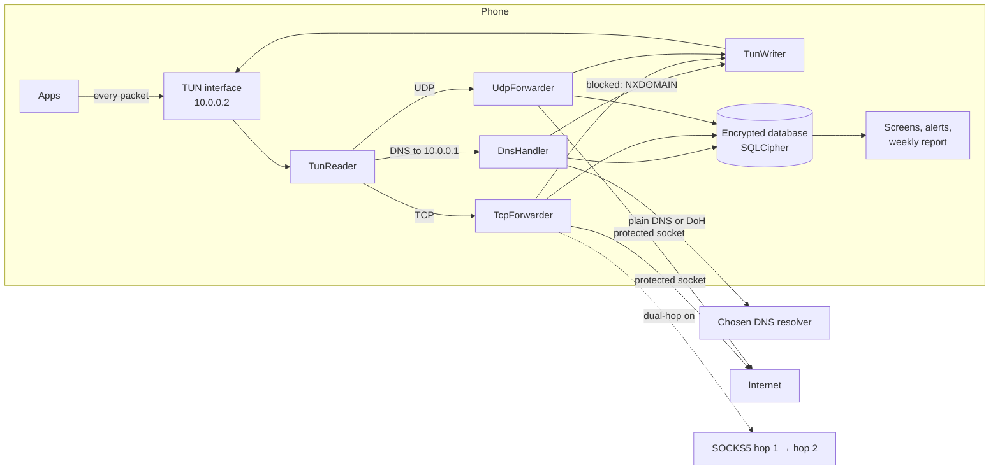

# How PrivacyGuard works

This document describes what the code does today, not what it was meant to do.
Where a feature has a limit or a known gap, it says so. File names are given so
you can check every statement yourself; paths are relative to
`app/src/main/java/com/privacyguard/` unless they start with `app/src/`.

Contents

1. [The big picture](#1-the-big-picture)
2. [The path of one connection](#2-the-path-of-one-connection)
3. [Architecture in detail](#3-architecture-in-detail)
4. [Protection levels and what decides a block](#4-protection-levels-and-what-decides-a-block)
5. [Detection logic](#5-detection-logic)
6. [Every screen: where each number comes from](#6-every-screen-where-each-number-comes-from)
7. [Privacy: what is stored, for how long, and what leaves the phone](#7-privacy-what-is-stored-for-how-long-and-what-leaves-the-phone)
8. [HTTPS inspection, MDM and SIEM](#8-https-inspection-mdm-and-siem)
9. [Known limits](#9-known-limits)

---

## 1. The big picture

PrivacyGuard is an Android app that creates a **local VPN**: a virtual network
interface on the phone that every app's traffic is routed into. Nothing is sent
to a VPN server. PrivacyGuard reads each packet, decides whether to let it out,
opens the real connection itself, and records what happened (which app, which
server, how much data, encrypted or not, screen on or off).

"Protected socket" means `VpnService.protect()` was called on it, so the
connection PrivacyGuard opens leaves through the real network instead of looping
back into the tunnel.

---

## 2. The path of one connection

Say a news app opens `https://ads.example.net/pixel`.

1. **DNS lookup.** The app asks for the address of `ads.example.net`. The tunnel
   gives apps only one DNS server, `10.0.0.1`, which is PrivacyGuard itself
   (`vpn/forwarder/DnsHandler.kt`).
2. **Anomaly check.** The name is checked for odd shapes and odd rhythms
   (section 5.2). Findings are stored, not used to block.
3. **Block decision** (section 4). If the name is blocked, PrivacyGuard answers
   *NXDOMAIN* ("no such name") at once, records a blocked lookup, and the app never
   connects. Otherwise the query goes to the resolver you chose: plain DNS to
   Cloudflare `1.1.1.1` by default, or DNS over HTTPS when you turn DoH on. The
   answer is checked (it must match the question) and handed back to the app.
   If the answer's CNAME chain points at a blocked name, the app gets NXDOMAIN
   instead (CNAME cloaking). A query with more than one question is dropped.
   PrivacyGuard remembers which address belongs to which name. Every UDP packet
   to port 53 goes to `DnsHandler`, whatever else is open on that flow.
4. **Connection.** The app sends a TCP SYN to the returned address. `TunReader`
   reads the packet and `PrivacyVpnService.onTcp` takes over:
   - DNS-over-TLS and DNS over QUIC (port 853, TCP and UDP) and DoH to the IP
     addresses of a built-in set of public resolvers (Google, Cloudflare, Quad9,
     OpenDNS, AdGuard) are dropped, so apps fall back to DNS that PrivacyGuard can
     see (`vpn/firewall/DnsBypassGuard.kt`). Plain DNS on UDP 53 to any address is
     answered by `DnsHandler` from your chosen resolver; DNS over TCP 53, and DNS
     over IPv6, are dropped so the app retries on UDP. A user Allow rule for one of
     the DoH addresses lets it through; port 853 stays closed. These drops are
     recorded as *DoT* or *DoH* in connection details.
   - The owning app is found: Android 10+ asks
     `ConnectivityManager.getConnectionOwnerUid`; older versions read
     `/proc/net/tcp` (`app/vpn/UidMapper.kt`).
   - Your rules are checked for the app, address and port.
5. **Relay.** `TcpForwarder` completes the handshake with the app itself and opens
   a protected socket to the server (or a SOCKS5 chain when dual-hop is on). It
   then copies bytes both ways, respecting the app's TCP window.
6. **First bytes.** For HTTPS the first bytes are a TLS *ClientHello*. It carries
   the server name (SNI) in clear text, so the hostname is known even if DNS was
   cached. The SNI gets the same block decision as a DNS lookup (section 4.2,
   `vpn/forwarder/NameBlockPolicy.kt`: the one function both use, so they cannot
   disagree); a blocked one resets the connection, so a blocked name reached
   without our DNS (hard-coded address, own resolver) is still stopped. It is
   recorded as stopped by *Server name (SNI)* and counted apart from DNS blocks.
   This runs before HTTPS inspection (enterprise) could take the connection.
   Encrypted DNS is checked here too: an SNI on the DoH lists (built in, plus
   HaGeZi's `doh-onlydomains`, refreshed with the other lists) resets the
   connection, and so does a ClientHello without an SNI to an address on HaGeZi's
   DoH IP list. A normal SNI to such an address passes, because many of those
   addresses also host ordinary sites. A user Allow rule for the name opens it. An
   SNI that is not a valid
   hostname is not used and raises *Invalid server name*; an SNI naming another
   site than the one DNS gave this address out for raises *Server name does not
   match DNS*, and the connection is recorded under the DNS name. The ClientHello
   is also fingerprinted (JA3 and JA4), checked for weak
   cipher suites, and compared with the app's learned TLS baseline (section 5.3).
   For plain HTTP the request line marks the connection as *cleartext*.
7. **Close.** When the connection ends, one row is written to the `connections`
   table: app, hostname (valid SNI, else the DNS name for that address, else the IP),
   bytes each way, duration, encryption, whether the app was on screen and whether
   the screen was on when it started, and the network it used. The app's profile
   for that host is updated (section 5.1). DNS lookups made by the system resolver
   on the app's behalf in the 60 seconds before are credited to the app.

UDP takes the same path through `UdpForwarder`, without a handshake. QUIC
(HTTP/3 over UDP port 443) is forwarded, but its SNI is read first: the
ClientHello sits in the client's Initial packets, whose keys come from public
values (RFC 9001/9369), so no interception is needed. It gets the same SNI and
DoH checks as TLS; a blocked flow is dropped for two minutes. What happens to
QUIC depends on the protection level (`vpn/firewall/QuicGate.kt`):

- **Block QUIC for better filtering** (Settings; on by default at Strict): every
  QUIC long-header packet (the Initial and the rest of the handshake) is
  dropped, so no QUIC connection can start, and apps retry over TCP, where the
  SNI is always visible. Other traffic on UDP 443 passes: calls over STUN/TURN,
  WireGuard and DTLS never set both top bits of the first byte, as a QUIC long
  header does. A QUIC connection that was already open when the setting was
  turned on (short headers only) is not cut; it ends on its own. QUIC is also
  blocked this way when HTTPS inspection asks for it. While dual-hop is on, all
  UDP 443 is dropped (section 4.4).
- **Standard and Strict:** a new QUIC flow's packets are held until its
  ClientHello is complete, so nothing reaches the server before the check. A
  QUIC Initial that cannot be read (unknown version or frame, or no complete
  ClientHello after 6 packets) is dropped, and the app falls back to TCP. Other
  traffic on UDP 443 (calls over STUN/TURN, VPNs) is not touched. Holding is
  limited to 128 flows and 512 KB at once; past that, new QUIC flows are dropped.
- **Minimal:** packets are forwarded while the ClientHello is read, and QUIC that
  cannot be read passes.
- **What is recorded.** A QUIC flow blocked by its server name is a blocked
  connection, stopped by *QUIC server name* (TCP's is *Server name (SNI)*; older
  rows stored SNI for both, and are shown as QUIC when they were UDP).
  Dropped QUIC (QUIC blocked, unreadable, too many waiting) is only counted, in
  Settings › Diagnostics › QUIC checks, since protection started: the app
  retries, and one history row per retry would flood the history.

---

## 3. Architecture in detail

### 3.1 The tunnel and packet engine

| Part | File | What it does |
|---|---|---|
| Service | `platform/android/PrivacyVpnService.kt` | Builds the tunnel (10.0.0.2/24 and fd00:1:fd00:1::2/64, resolver 10.0.0.1, default routes for IPv4 and IPv6), starts everything below, writes history. |
| Reader | `vpn/tunnel/TunReader.kt` | Reads packets from the TUN file descriptor, parses IPv4 and IPv6, hands them on. |
| Writer | `vpn/tunnel/TunWriter.kt` | One queue and one thread that write packets back to apps (DNS answers, TCP data, UDP replies). |
| TCP | `vpn/forwarder/TcpForwarder.kt` | A TCP state machine per connection: ends the app's connection locally and relays it over a real socket, with flow control and retransmission towards the app. |
| UDP | `vpn/forwarder/UdpForwarder.kt` | One protected datagram socket per flow; replies larger than the MTU are fragmented. |
| Sessions | `core/session/` | The table of live connections; a reaper closes idle ones. |

**IPv6.** TCP and UDP over IPv6 go through the same forwarders as IPv4. Other
IPv6 protocols are dropped and counted (Diagnostics shows the count). DNS over
IPv6 to outside resolvers is dropped so apps use the tunnel's IPv4 resolver.

**Start-up order.** Your rules and the blocklists are loaded *before* the tunnel
opens, so no traffic is ever carried unfiltered. The blocklists come from a plain
cache file of the last loaded lists (`app/core/blocklist/BlocklistCache.kt`;
public lists only), which takes a few seconds. They are then reloaded from the
database in the background, in case they changed while protection was off.
Without a cache (the very first start) the tunnel waits for the database, about
half a minute with the full lists.

### 3.2 DNS

| Feature | Behaviour |
|---|---|
| Resolver | Plain DNS to the address you set (default Cloudflare `1.1.1.1`, with its second address as fallback). Never a different company's resolver. If it cannot be reached, the app gets *SERVFAIL*. |
| DoH | Optional, off by default. Cloudflare (`cloudflare-dns.com`), Google (`dns.google`) or Quad9 (`dns.quad9.net`). Connects to a fixed bootstrap address so looking up the DoH server does not loop through the tunnel; TLS still checks the name. A failed DoH lookup answers *SERVFAIL* and is never resent as plain DNS. |
| Answer checks | The answer must parse and match the question's ID and name, or it is dropped. A CNAME to a blocked name turns the answer into NXDOMAIN. Queries with more than one question are dropped. |
| Network checks | On plain DNS, a public name answered with a private or null address is recorded as *tampered*. A lookup of a random `.invalid` name that gets an address means the network *hijacks* DNS. A DoH certificate that does not validate means something is *intercepting* TLS. These feed network trust (section 5.6). |

### 3.3 Storage

| Store | Content | Protection |
|---|---|---|
| `privacyguard.db` (Room) | History: connections, DNS lookups, app profiles, DNS anomalies, TLS alerts and baselines, network trust, sensor events, app stats, payloads (enterprise), blocklists. | SQLCipher; the key is wrapped by an Android Keystore key (`app/core/security/DatabaseEncryption.kt`). |
| `config.db` | Your rules and blocklist switches. Kept apart so history migrations can never delete rules. | SQLCipher, same scheme. |
| Shared preferences | Settings. | App-private, not encrypted. Passwords (SOCKS hops, SIEM key) are stored separately, encrypted with a Keystore key (`SecureSecretStore`). |
| `files/exports/` | PCAP captures, CSV and IT-report exports. | App-private, **not encrypted** (they are made to be opened by other tools). Deleted after 24 hours. |
| `no_backup/blocklist_*.txt.gz` | Cache of the loaded blocklists. | App-private, plain. Public lists only. |
| `ct_baseline` preferences | Highest certificate ID seen per domain, for Certificate Transparency. | Keys are SHA-256 hashes of the domain, not the names. |

### 3.4 Background work

| Worker | When | What |
|---|---|---|
| `BlocklistUpdateWorker` | First start (any network); every 7 days on an unmetered network (battery not low); any network once a list has had no successful download for 14 days (checked daily); "Refresh now" at any time | Downloads the lists in 3.5 and tells the VPN to reload. Each list's last success is stored; a run fetches only the lists that are due, and if one fails the run is retried with backoff (1 h, doubling) and fetches only the failed lists again. |
| `PruneWorker` | Daily | Deletes history older than the retention period (default 30 days), caps the big tables (500,000 connections, 500,000 DNS lookups, 5,000 payloads), deletes exports older than 24 h. |
| `PruneWorker` (vacuum) | Weekly, charging and idle | Compacts the database so freed space is returned. |
| `WeeklyReportWorker` | Weekly, if switched on | Posts the weekly summary notification. |
| `ExodusUpdater` | At most weekly | Refreshes the Exodus Privacy tracker list. |

### 3.5 Blocklists

| Source | Category | URL host |
|---|---|---|
| HaGeZi TIF mini (`wildcard/tif.mini-onlydomains.txt`) | malware: every level | raw.githubusercontent.com |
| HaGeZi Pro mini (`wildcard/pro.mini-onlydomains.txt`, ~80k names) | ads: Standard | raw.githubusercontent.com |
| HaGeZi Pro (`wildcard/pro-onlydomains.txt`, ~207k names) | ads: Strict | raw.githubusercontent.com |
| OISD small (`domainswild2`) | ads: Strict | small.oisd.nl |
| HaGeZi DoH domains (`wildcard/doh-onlydomains.txt`) | doh: DNS-bypass guard only, never DNS blocking | raw.githubusercontent.com |
| HaGeZi DoH IPs (`ips/doh.txt`; private and special addresses refused) | doh_ip: DNS-bypass guard only | raw.githubusercontent.com |
| Built-in seed (about 70 hand-picked names) | ads, trackers, malware, telemetry | in the app |

Every HaGeZi file is fetched again from cdn.jsdelivr.net (jsDelivr's GitHub mirror)
when raw.githubusercontent.com fails. StevenBlack, EasyList, EasyPrivacy, HaGeZi
Light and URLhaus are no longer downloaded; their stored rows are deleted once the
HaGeZi lists that replace them have downloaded.

The two DoH lists (about 3,300 names and 1,400 addresses in October 2026) are not
part of any protection level and are not counted as trackers; they only feed the
DNS-bypass guard (section 2, steps 4 and 6). The guard's built-in names and
addresses always apply as well.

On a test phone in October 2026 this gave about 179,000 ad names, 43,000 tracker
names, 428 malware names and the built-in telemetry names; about 216,000 distinct names at Strict
(the lists overlap). Lists are held in memory as two hash sets (`vpn/firewall/DomainFilter.kt`);
an entry blocks the name and every subdomain.

Downloads are HTTPS only, without redirects, and read line by line. Each entry is
checked (`app/core/blocklist/ListEntryValidator.kt`): converted to punycode, and
refused if it is not a valid name, is a public suffix (`co.uk`, `com.au`; the Public
Suffix List bundled with OkHttp), or mixes scripts within a label (look-alike
names). A source with more than 1.5 million names is refused whole, and so is a
download with fewer than half the names of the stored copy of that list (a broken
or truncated list; the event is recorded, and the run retries later). The first
download of a list is never refused for its size. A failed or refused download
keeps the lists already loaded.

---

## 4. Protection levels and what decides a block

### 4.1 Levels (`core/filter/ProtectionLevels.kt`)

| Level | Blocks |
|---|---|
| Minimal | Malware and phishing lists only. |
| Standard (default) | Minimal + ads + trackers. |
| Strict | Standard + system telemetry (Microsoft, Apple, Amazon, Mozilla, Dropbox). Some features can break. Google Safe Browsing is never blocked: it powers the browser's phishing and malware warnings. |

A source or category you switch off in Ad privacy stays off at every level.

### 4.2 Order of decisions for a DNS name (`vpn/forwarder/DnsBlockDecision.kt`)

1. **Your Block rule** for the name: blocked.
2. **Malware and phishing lists**: blocked, unless you have an Allow rule for the
   name *and* you accepted the warning shown when you created it ("Allow anyway").
3. **Your Allow rule**: resolved. It beats the ad, tracker and telemetry lists and
   the Ad-SDK policy.
4. **Lists for your level**: blocked.
5. **Ad-SDK policy** (Ad privacy → "Block ad and attribution SDKs", on by
   default): blocks ad and attribution SDK servers when the app asking is not
   that SDK's own company's app, and keeps login, push and deep-link hosts open
   even when a list contains them.

Rules match the exact name you type. Write `*.example.com` to cover
`example.com` and every subdomain. Rules for IPv6 addresses are not supported;
the dialog says so.

### 4.3 Connection rules

Rules can also match an app, an IPv4 address or range, a port, "only in the
background", or a connection's encryption ("block cleartext", "block weak TLS").
They are re-checked every second on live connections, so a new rule cuts an open
connection.

### 4.4 Dual-hop (SOCKS5 chain)

When both hops are set, **every TCP connection** goes device → hop 1 → hop 2 →
server, and **DNS goes through the chain too when DoH is on** (DoH is TCP). SOCKS5
`CONNECT` carries only TCP, so:

- QUIC (UDP 443) is always dropped while dual-hop is on, and apps fall back to TCP
  through the chain.
- Other UDP (calls, games, video chat) goes directly, unless you switch on
  "Block UDP outside the chain", which drops it.
- With DoH off, plain DNS goes directly to your resolver. Turn on DoH.
- SOCKS5 is not encrypted. Hop 1 sees your IP, every destination and your hop 2
  user name and password; hop 2 sees the destinations but not your IP. Only HTTPS
  (TLS) keeps the content private.

---

## 5. Detection logic

Nothing in this section blocks traffic. It produces findings, alerts and scores.

### 5.1 Per-destination profiles and risk (`core/metadata/MetadataEngine.kt`)

For each (app, host) pair PrivacyGuard keeps: connection count, bytes each way,
first and last seen, average and shortest interval between connections, share
made in the background, and a 24-hour histogram. The risk score is the sum of
these signals × 10, capped at 100:

| Signal | Points |
|---|---|
| Host or a parent is on any blocklist or the curated ad list ("known tracker") | 6 |
| Unencrypted, and not a local device or an OS connectivity check | 7 |
| Weak TLS version | 4 |
| More than 80 % in the background, over 5 connections | 5 |
| Average interval under 60 s over more than 10 connections, not a push host | 6 |

70 or more is "high risk", 40–69 "medium".

**Tracker names on screens** come from a separate table: 55 hand-written tracker
entries (Google AdMob, Meta, AppsFlyer…) plus the Exodus Privacy list
(`app/core/tracker/`). A tracker owned by the same company as the app is labelled
first-party, not tracker.

### 5.2 DNS anomalies (`vpn/inspector/DnsAnomalyDetector.kt`)

Checked on every lookup an app makes (not PrivacyGuard's own). A, AAAA and HTTPS
queries for one name within 1 second count as one lookup.

| Finding | Rule | Severity |
|---|---|---|
| Many subdomains | More than 5 labels, not a known CDN | 6 |
| Long name | More than 50 characters, not a known CDN | 5 |
| Random-looking name | First label ≥ 12 characters, Shannon entropy ≥ 3.4 bits per character, ≥ 15 % digits, not a CDN. Catches generated (DGA) names while normal words and brand names stay below. | 8 |
| Lookup burst | More than 30 *different* names in 10 seconds | 4 |
| Repeated lookups | The same name 8 or more times in 10 seconds (possible beaconing) | 5 |

Two more findings come from the TLS server name (section 2, step 6;
`core/tls/SniCheck.kt`): *Invalid server name* (the SNI is not a hostname: an IP,
bidi or control characters, HTML) and *Server name does not match DNS*.

Each finding is reported once per app and host per 24 hours. A *Lookup burst* is reported
once per app per 24 hours, whichever host tipped it: one news page looks up dozens
of ad hosts, and per host each one would be its own alert. For the three
name-shape findings the base domain is used instead of the host, because CDN-like
hosts are unique by design. CDN suffixes (CloudFront, Akamai, Fastly, Facebook and
TikTok CDNs, Google video…) are exempt from the shape checks.

### 5.3 TLS checks (`core/tls/`)

| Check | Rule | Result |
|---|---|---|
| JA3 threat list | The ClientHello's JA3 hash is one of 35 hashes known from malware families. | Alert, severity from the list, notification once per hash. |
| Weak ciphers offered | The ClientHello *offers* NULL, EXPORT or anonymous suites (critical, severity 9), or more than two of RC4 / DES / 3DES (severity 6). It checks what is offered, not what the server picked. | Alert. |
| TLS version | TLS below 1.2 on the connection marks it *weak TLS*. | Encryption status, risk signal. |
| Fingerprint baseline (`TlsBaselineEngine.kt`) | Per app, the JA4 fingerprints it uses. For the first 7 days every new one is learned. Within 24 hours after the app, the OS build, WebView or Conscrypt is updated, new ones are learned silently. Otherwise a new fingerprint is stored and raises **one** alert. | "TLS fingerprint changed" alert and notification. |
| Certificate Transparency (opt-in) | Every 6 hours, the registrable domain (`bbc.co.uk`, not `co.uk`) of up to 50 contacted servers is looked up on crt.sh, without redirects and reading at most 2 MB. The first answer is the baseline; later certificates with a higher ID raise an alert. Turning it off stops at once and forgets the queue. | "New certificate" alert. |

### 5.4 Behaviour changes ("App Behavior DNA", `app/core/behavior/BehaviorDnaAnalyzer.kt`)

An app's baseline is ready after 7 days of history or 40 connections. Then:

| Finding | Rule |
|---|---|
| New destination | A host first seen in the last 24 h with 3+ connections, while the app has older destinations (3+ days). Up to 4 per app. |
| Unusual hour | A host whose busiest hour holds 8 % or less of the app's activity, and is mostly (≥ 50 %) background. |
| Upload spike | 2 MB or more sent to one host in the last 24 h, mostly in the background, and 3× the app's average per host. |
| Background beacon | ≥ 85 % background, 8+ connections, average interval 10 s – 15 min, not a push host. |

All are *medium* (reasons to look, not proof), except an upload spike of 10 MB or
more, which is *high*. High findings raise a notification from the VPN service, so
also while the app is closed, once a day per app, host and kind (the record of
what was notified keeps only hashes).

### 5.5 Timer-like contacts (Home card, `HomeEvidence.beacons`)

In the last 24 hours, the same app and host contacted at least 6 times, with gaps
between 5 seconds and 10 minutes whose spread is under 25 % of the average gap.
Push channels (Google FCM, Apple, Samsung, Meta and WhatsApp chat, Signal, Mozilla, Windows) and the OS connectivity checks are left out,
because they run on a timer by design.

### 5.6 Network trust (`app/core/network/NetworkTrustAnalyzer.kt`)

Judges the network, not the apps on it. Starts at 100:

| Sign | Penalty |
|---|---|
| TLS interception seen (a well-known server's certificate was not trusted) | −40 |
| DNS hijacking (a reserved `.invalid` name got an address) | −30 |
| Open Wi-Fi without encryption | −30 |
| Tampered DNS answers (public name → private address) | −10 each, at most −30 |
| Captive portal | −15 |

80 or more is *Trusted*, 55–79 *Watch*, below that *Reduced*. On a *Reduced*
Wi-Fi network, Home suggests Strict. Mobile networks are scored but never get the
suggestion. Without location permission Android does not tell apps a Wi-Fi
network's name, so "No thanks" on the suggestion applies to all Wi-Fi networks,
and the card says so.

### 5.7 Stalkerware score (`app/core/detection/StalkerwareDetector.kt`)

For apps that are not preinstalled system apps:

| Signal | Points |
|---|---|
| No launcher icon | 30 |
| Not installed from an app store (Play, Galaxy Store, Huawei, Amazon, Xiaomi, Oppo) | 20 |
| Asks for background location | 20 (foreground location only: 5) |
| A host with ≥ 80 % background traffic | 10 |
| A host with ≥ 10 connections of which half or more were between 00:00 and 05:59 | 15 |
| 1 MB or more uploaded to one host, ≥ 75 % in the background | 15 |

70 or more shows "Possible stalkerware" on the app; 40 or more shows the score.
These are the traits that set monitoring apps apart; traits that ordinary apps
share (any location permission, mostly background traffic on its own) were
removed because they flagged messengers and banking apps.

### 5.8 Camera & Mic Watch (`app/adprivacy/SensorUsageWatcher.kt`)

Android reports *that* the microphone (`AudioRecordingCallback`) or a camera
(`CameraManager.AvailabilityCallback`) is in use, but not *which app*. PrivacyGuard
records start and end and whether the screen was on. If the screen was on, it
names the app that was on screen 1.5 seconds after the start (needs Usage access).
If the screen was off, it names no app ("App not known (screen was off)"),
because the last app on screen is then not the one using the sensor.
Watching runs only while protection runs. A use still open when the process died
(crash, app update) is marked "end not recorded" when watching starts again; the
"Did any app use my mic?" search counts such a use only if it started inside the
chosen window.

### 5.9 Is there a "retro-hunt"?

No. Detection runs on traffic as it happens. When the blocklists or the JA3 list
change, past history is **not** re-scanned and no alerts are raised for old
connections. The only thing that changes for old rows is the *tracker label*
shown on screens, because tracker names are looked up when a screen is drawn,
with the current lists.

---

## 6. Every screen: where each number comes from

All counts come from rows in the database. Each tappable number opens the list it
was counted from, built for the same time window, so the number and the length
of the list are equal (`app/ui/traffic/HomeEvidence.kt`).

**"Blocked"** means the same thing everywhere (`app/data/repository/BlockStats.kt`):
DNS lookups answered *NXDOMAIN* by the lists or your rules, plus connection
attempts PrivacyGuard dropped (rules, DNS-bypass guard, cleartext rule).
Apps retry a blocked connection at once, from a new port each time (Chrome tried
one blocked DoH server about six times a second). So one row is written per app,
host, port, protocol and *Stopped by* per minute (fixed windows, `core/session/BlockRowGate.kt`);
the retries are counted, not written. DNS lookups already merge repeats within 10 s.
The exact number of attempts is in Settings › Diagnostics › *Blocked connection
history*: attempts = written + merged, since protection started.
**"Block rate"** = blocked lookups ÷ all lookups (lookups, not connections, so a
visit is not counted twice).

**Encryption** counts only connections whose encryption could be seen (a TLS or
QUIC handshake, or a plain HTTP request), left blocked ones, local devices and the
OS's connectivity checks out. Encrypted share = encrypted ÷ (encrypted + cleartext).

### Home

| Number | Calculation |
|---|---|
| Privacy score (0–100) | `app/core/privacy/PrivacyScoreCalculator.kt`, last 24 h: **Encryption** 50 × encrypted share; **High-risk apps** 25 × (1 − apps with a profile ≥ 70 ÷ 10); **Blocklist coverage** 15 × (1.0 for ≥ 250k names at your level, 0.8 for ≥ 100k, 0.55 for ≥ 50k, 0.3 for fewer, 0 for none); **Background** 10 × (1 − background share). Blocked lookups are not an input, so blocking more never lowers the score. With nothing observed yet the score is 50. Home, Stats, the weekly report and the IT report all use this one function. |
| Blocked (24 h) | BlockStats for the last 24 h, with the number of distinct names behind it. |
| Encryption health | Encrypted share, last 24 h. |
| Cleartext | Plain-HTTP connections to the internet in the last 24 h that went through (not to local devices, not OS checks). |
| Throughput, live connections | Bytes per second over all sessions, measured about once a second (`LiveTrafficMeter`). |
| Bell badge | Number of items in the alert inbox. |
| Cards | Behavior DNA (findings from 5.4 for hosts active in 7 days); IPv6 sessions (24 h); Kill switch (on only when Android reports Always-on VPN with lockdown); Random-looking names (5.2, 7 days); Night activity (sessions started 00:00–05:59 with the screen off, 24 h); Timer-like contacts (5.5); Large background upload (biggest upload in 24 h while the app was off screen); Network trust (5.6); Background activity (connections while the app was off screen, 24 h); Cleartext. |

### Apps

Per app, over its recorded history: connections, data, cleartext count, highest
profile risk (5.1), stalkerware score (5.7). **Privacy grade** starts at 100 and
subtracts 0.4 × highest risk (max 40), 5 per cleartext connection (max 20), 2 per
background connection (max 10) and 0.3 × stalkerware score (max 30): A ≥ 80,
B ≥ 60, C ≥ 40, D ≥ 20, otherwise F. The "high risk" badge counts apps with risk
or stalkerware score ≥ 70.

### Traffic and connection lists

Rows from `connections` (and blocked lookups from `dns_queries` where a list is
about blocking), newest first, with no row limit. A host's detail screen shows its
tracker label (5.1), its anomalies and every app that contacted it.

### Stats

Tiles for the last 24 h: connections, blocked, cleartext, data, block rate,
encryption, and the same privacy score as Home. Top blocked names come from
`dns_queries`. "Countries" first checks a built-in table of 64 address ranges of large providers
(Google, Amazon, Microsoft, Meta, Cloudflare…), which also names the owner; any
other IPv4 address gets the country its block is registered in, from the five
regional internet registries' public allocation files (`assets/geoip_v4.bin`,
rebuilt with `tools/geoip/GenerateGeoIp.java`). That is the registrant's country,
not where the server stands: a CDN address shows the CDN's home country. IPv6
addresses show as unknown. The timeline mixes DNS anomalies (critical at
severity ≥ 9, high ≥ 7, else medium), blocked items and behaviour findings.
Remembered networks show their trust score.

### Alert inbox

The last 7 days of DNS anomalies and TLS alerts (JA3 threats, weak ciphers,
fingerprint changes, new certificates), plus one cleartext entry per app.

### Security analysis

Counts of every stored JA3 threat, weak-cipher and CT alert (all of them, not a
recent sample), the newest of each type, and the TLS baseline status per app
(learning, ready, alerts).

### Ad privacy

Blocked in the last 24 h and block rate (BlockStats); "N blocked at <level>" =
distinct names on the lists your level uses, plus the curated ad hosts at
Standard and Strict; per-category and per-source counts and switches; your own
domain rules; the apps that contacted the most trackers in 24 h.

### Why am I seeing this ad? / Camera & Mic Watch

Links to the ad settings of Google, Meta and others; the Ad-SDK switch; a
permission audit of apps; the sensor log from 5.8, grouped by app.

### Rules

Your rules, with hit counts. Suggestions (`app/ui/rules/RuleSuggestions.kt`) look
at the last 7 days: an app with 3 or more unencrypted internet connections gets
"Block unencrypted connections of X", an app with 100 or more background
connections gets "Block X in the background". An app you already blocked, or that
a rule already covers, gets none. Dismissed suggestions stay dismissed.

### Diagnostics (Settings)

Tunnel state, kill switch, Private DNS, a test lookup, **upstream DNS** (the
running VPN does one real lookup over its own path), external IP (opt-in, asks
api.ipify.org), DNS leak check, IPv6 packets dropped, installed apps with internet
access, packets captured.

### Payloads (enterprise only)

Inspected HTTPS requests and responses, see section 8.

### PCAP export (Home)

Raw packets in both directions (what apps send and what they receive, including
DNS answers PrivacyGuard makes) in Wireshark format. Stops at 100 MB or when
protection stops; deleted after 24 hours.

### CSV export (Stats)

Every cell goes through `core/utils/CsvCell.kt`: a cell starting with `=`, `+`,
`-`, `@`, a tab or a carriage return gets a leading apostrophe and is quoted, so a
spreadsheet never runs an app label or host name as a formula.

### Screenshots

In release builds every screen except onboarding sets `FLAG_SECURE` from its first
frame (`ui/SecureScreens.kt`): no screenshots, screen recording or recent-apps
preview of your history. Settings → "Allow screenshots" (off by default) turns
this off at once. Debug builds never set it. Hosts and app labels are escaped
where they are stored (bidi overrides, control characters), so no screen or
export shows them raw.

---

## 7. Privacy: what is stored, for how long, and what leaves the phone

### 7.1 Stored on the phone

Everything in 3.3. History is kept for the retention period you set (default 30
days) and capped in size. DNS anomalies, TLS alerts, sensor events and profiles
older than the retention period are deleted too. "Clear all collected data"
erases every history table, exports, PCAPs, the CT record and what the running
VPN holds in memory, then compacts the database. Settings, rules and blocklists
stay (`app/data/repository/LocalDataEraser.kt`; a test fails if a new table is not
classified).

### 7.2 What leaves the phone

Nothing is ever sent to the makers of PrivacyGuard. The app contacts:

| Destination | When | What it learns |
|---|---|---|
| Your DNS resolver (Cloudflare 1.1.1.1 by default) | Every lookup | The names apps look up. Encrypted only with DoH. |
| raw.githubusercontent.com, cdn.jsdelivr.net (mirror, only when GitHub fails), small.oisd.nl | Blocklist download: at first start, then weekly on Wi-Fi or another unmetered network, on any network after 14 days without a successful download, failed lists retried, and whenever you tap "Refresh now" (about 4 MB compressed for all lists) | That a PrivacyGuard install exists, your IP address. |
| reports.exodus-privacy.eu.org | Tracker list, at most weekly | Same. |
| crt.sh | Only if Certificate Transparency is on | The base domains of servers your apps contact. |
| api.ipify.org | Only if the external-IP check is on, when you run Diagnostics | Your IP address. |
| Your SOCKS servers | Only with dual-hop | SOCKS5 is not encrypted: hop 1 sees your IP, hop 2's address and login, and every destination; hop 2 sees the destinations, not your IP. HTTPS content stays encrypted. |
| Your organisation's SIEM | Enterprise only, if configured | Inspected HTTPS requests and responses (section 8). |

Exports (PCAP, CSV, IT report) leave the phone only when you share them. A test
(`OutboundHostsDisclosureTest`) fails if the code contacts a host that the
onboarding text does not name.

### 7.3 Notifications and logs

Notifications are built through `platform/android/PrivateNotifications.kt`: private
on the lock screen, with a public version that names no app or server. By default
the full text also says only what kind of alert it is ("Unencrypted connection",
"Possible malware connection"), and the weekly report leaves out the top app.
Settings → "Show details in notifications" (off by default) brings the names
back. Note that an app with notification-listener access can still read and
dismiss them; the alert inbox is the record.

Release builds strip debug and info logs. Warnings and errors on the network
paths do not log addresses, ports, hosts, package names or exception messages.

---

## 8. HTTPS inspection, MDM and SIEM

There is one app (the consumer build was removed on 2026-10-23). Everything below
is in it, and HTTPS inspection is **off by default**. On a company-managed phone the
organisation's MDM can switch it on and give consent on the user's behalf
(`mitm_enabled`, `mitm_consent_given`); nothing else can (security review,
2026-10-23). While it decrypts, the VPN notification and the Home screen say so
(`InspectionStatus`), and when the MDM turns it on the user is notified once.
When the managed configuration disappears, what the MDM switched on or consented
to is withdrawn (`ManagedConfigApplier.withdrawOrganisationSettings`).

**HTTPS inspection** (`app/src/enterprise/java/com/privacyguard/vpn/mitm/`): the
user gives consent during onboarding and later switches inspection on in the
Payloads screen. PrivacyGuard then creates its own certificate authority, which the
user installs in Android's settings, and acts as a proxy for apps that trust user
certificates (most apps do not, since Android 7; browsers and apps that opt in
do). It records requests and responses up to a size limit, flags apps that pin
their certificates, can redact personal data, and keeps payloads for its own
retention period. Only PrivacyGuard's own UID is exempt from inspection.
Redaction runs on two bounded workers, not the capture thread; its scanners are
one-pass and each call has a time budget. When time runs out the text is
replaced, never stored or shipped unredacted. Redaction covers headers and text
bodies; URL query strings, form data and binary bodies are not redacted yet, in
the local log or in what is shipped to a SIEM. Turning inspection off deletes the CA key and the stored
payloads. **Android keeps the installed certificate after PrivacyGuard is
uninstalled**; onboarding tells the user how to remove it (Settings → search
"User certificates" → "PrivacyGuard Enterprise CA" → Remove).

**SIEM**: inspected payload records are queued and sent to the configured
endpoint in batches (100 events or 60 seconds; the queue is held in memory only), only over HTTPS, with a bearer API
key, an optional certificate pin and an optional body signature (`SiemEndpoint.kt`).

---

## 9. Known limits

- **Encrypted content is not visible** unless HTTPS inspection is on and the app
  trusts user certificates (most apps on Android 7+ do not). PrivacyGuard sees who, when, how much and how it is encrypted.
- **Attribution is best effort.** DNS lookups are made by Android's resolver, not
  by the app, so they are credited to an app only when the app connects to that
  name within 60 seconds. Camera and mic use is credited to the app on screen,
  which can be wrong; with the screen off no app is named.
- **Apps that bring their own resolver** over TLS, QUIC or DoH to unknown servers,
  or connect to hard-coded addresses, skip DNS blocking. Their TLS and QUIC
  connections are still blocked by server name (section 2, step 6), but a
  connection without a server name (plain TCP or UDP to an address, encrypted
  ClientHello) is not. Only the standard encrypted-DNS port, built-in DoH
  addresses, and names and (without an SNI) addresses on the DoH lists are blocked
  as DNS bypass. Until the DoH lists are first downloaded (and after a failed
  download), only the built-in ones apply. The downloaded lists include a few
  whole domains that also serve other things (for example `cloudflare-gateway.com`
  used by Cloudflare WARP, and HTTPDNS services some apps use for their own lookups);
  a user Allow rule for the name opens them.
- **A browser set to one encrypted-DNS provider stops loading pages.** Chrome's
  "Use secure DNS" with a specific provider (for example Cloudflare) sends every
  lookup to that DoH server and never falls back. Layer 2 blocks the server
  (recorded as stopped by *Encrypted DNS server*), so Chrome shows
  `DNS_PROBE_FINISHED_BAD_SECURE_CONFIG` for every page; ads are blocked, but so
  is everything else. Chrome's default ("Use your current service provider")
  falls back to the system resolver and works. Tested on an Android emulator
  (API 37) on 24 October 2026.
- **When the tunnel is down, nothing is filtered.** A test on 14 October 2026
  (Samsung, Android 13): after the app crashed, blocked names resolved directly
  until protection was back. Network changes (airplane mode, Wi-Fi to mobile)
  leaked nothing, because the tunnel stays up. With Always-on VPN and "Block
  connections without VPN", nothing leaked, but nothing else got through either.
- **A crash is not always recovered by Android.** Android restarted the service
  after a quick second crash, but after an ordinary crash it did not, even with
  Always-on. PrivacyGuard therefore watches itself: a small `:watchdog` process,
  bound by the VPN service, learns from the binder driver the moment the VPN
  process dies and sets one exact alarm that starts protection again (Settings →
  "Automatic restart after a crash", at most 3 restarts in 30 minutes). Nothing
  is scheduled while protection is healthy; a non-wakeup backup alarm covers the
  case where both processes die. Exact alarms need "Alarms & reminders" access
  (not pre-granted on Android 14+); without it, or past the restart limit, the
  user gets "Protection stopped" instead. Either way the dead service's
  "Protection on" notification is removed at once: Android kept it up for about
  a minute after a crash (and the app may not remove it itself while Android
  still counts the service as running), so the watcher stops the dead service's
  record first. Measured on an API 37 emulator, 25 October 2026: removed 12–54 ms
  after the kill, with and without a restart. Not covered: Force stop, and an app that
  Android marked as "crashed too many times", which Android itself will not
  start in the background until the user opens it. The start fails closed: the
  tunnel takes every route first and is read only once the filters are loaded.
  (This design replaced a 30-second deadman alarm on 15 October 2026 and has
  only been unit-tested so far; see docs/security-test-2026-10-14.md.)
- **First start after install:** until the first download (about a minute after
  install) only the built-in lists apply. A download writes the start-up cache, so
  later starts take a few seconds. Only a start whose cache is missing (for example
  the first one after this cache was introduced) waits about half a minute for the
  database.
- **Memory:** with all lists loaded the app uses about 200–260 MB (PSS) on a test
  phone, about 68 MB of it Java heap.
- **No in-app kill switch.** Only Android's Always-on VPN with "Block
  connections without VPN" blocks traffic once the tunnel is gone; Settings has a
  button to Android's VPN settings. The app shows lockdown as on only when
  Android reports it, and as "not checked" while protection is off or before
  Android 10.
- **Dual-hop carries TCP only** (section 4.4).
- **Rules:** exact names unless written `*.name`; no IPv6 rules.
- **Weak-cipher alerts** are about what an app *offers*, which old libraries do
  even when the server picks a strong suite.
- **JA3 threat matching** uses 35 published hashes. JA3 values are shared by many
  programs that use the same TLS library, so a match is a lead, not proof.
- **Countries** are registration countries (RIR data), not server locations;
  IPv6 addresses have none, and the network owner is known only for 64 big
  provider ranges. The table is as current as the last time it was rebuilt.
- **Network trust "No thanks"** applies to all Wi-Fi networks (no location
  permission, so networks cannot be told apart reliably).
- **TLS fingerprints:** learning covers what an app does in its first 7 days, so a
  feature used later can alert once; new fingerprints are accepted silently
  after an update, which is also when a bad SDK could arrive; QUIC is not
  fingerprinted.
- **History is written when a connection closes** (or after 5 minutes idle for
  TCP, 30 seconds for UDP), so open connections appear a little later.
- **Large DNS answers** (over 4 KB) need DNS over TCP, which the tunnel does not
  offer, so they fail.
- **Updating the app stops the VPN** unless Always-on VPN is on for it.
- **Meta app events** share `graph.facebook.com` with "Continue with Facebook",
  so they cannot be blocked at DNS without breaking login.
- **PCAP files are not encrypted** while they exist (at most 24 hours).
- **No retro-hunt** (5.9).
